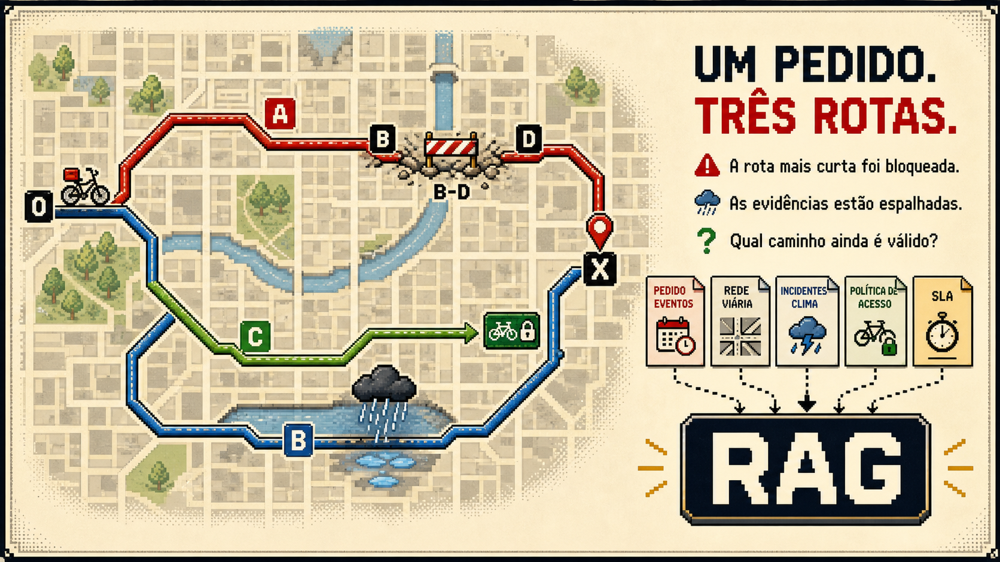
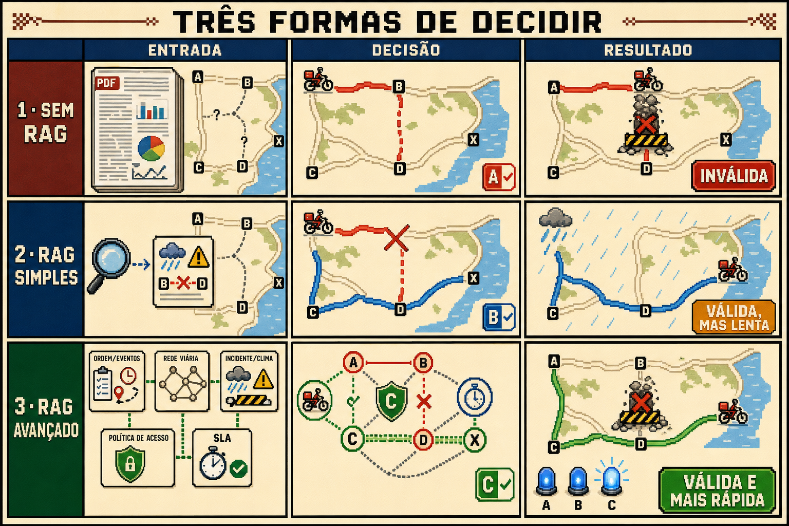
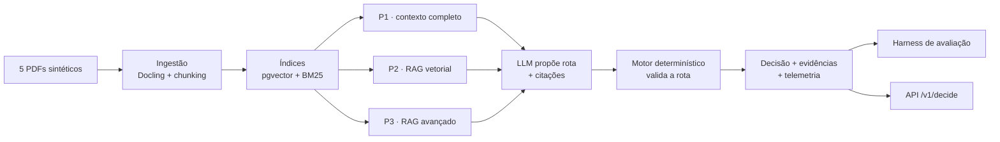

# Last Mile RAG Lab

<div align="center">

**Benchmark reproduzível de RAG aplicado a decisões logísticas sob restrições dinâmicas.**


</div>

## Em 30 segundos

Um pedido precisa de uma rota, mas a resposta certa depende de cinco documentos diferentes
(pedido, malha, incidentes, políticas de acesso e SLA). Nenhum deles sozinho resolve.

O projeto compara **três estratégias** para levar essas evidências até um LLM: contexto completo,
RAG vetorial e RAG avançado (híbrido + filtros + reranking + ferramentas). Em todas elas, **o LLM
propõe e um motor determinístico valida**: se a rota proposta passa por um trecho bloqueado, ela é
reprovada, nunca aceita.

A avaliação não premia acerto por sorte. Uma resposta só conta como **"correta pelos motivos
certos"** se a rota estiver certa, for válida no motor e vier com citações que cubram as evidências
necessárias.

**Resultado até aqui:** a hipótese de que o RAG avançado venceria **não se confirmou**. A
investigação mostrou que o gargalo é o **recall** contra distratores do corpus, não a geração.
Os números e o diagnóstico estão em [Resultados](#resultados).

## O problema



O caso de referência é o pedido sintético `ORD-042`:

> Qual rota operacionalmente válida minimiza o tempo estimado, considerando o estado do pedido,
> o modal, a malha vigente, incidentes ativos, acessos temporários e o SLA?

A rota mais curta (A) passa pelo segmento `SG-BD`, interditado pelo incidente `INC-Z03-042`.
A rota correta (C) depende de um acesso temporário que só vale para bike, em um horário específico.
O corpus tem de propósito IDs parecidos, outras regiões, versões revogadas e eventos fora de ordem,
para que a recuperação não seja trivial.



*A grade acima é a hipótese inicial do experimento. O que de fato aconteceu está em
[Resultados](#resultados).*

## Arquitetura



| Camada | O que faz | Onde |
|---|---|---|
| Corpus | 5 PDFs sintéticos e determinísticos, com distratores propositais | `tools/`, `data/corpus/` |
| Ingestão | Parsing layout-aware com Docling, chunks com metadados (documento, tipo, página, versão, entidades, hash da fonte) | `ingest/`, `pipelines/parsing.py` |
| Armazenamento | PostgreSQL 16 + pgvector em Docker: busca vetorial, lexical e filtros por metadados | `db/` |
| Pipelines | Três estratégias com **o mesmo contrato de saída** | `pipelines/` |
| Motor | Regras de malha, incidentes, acesso, SLA e risco. É a fonte da verdade, nunca o LLM | `engine/`, `domain/` |
| Avaliação | Rubrica 100% automática, casos contrafactuais, relatório JSON + Markdown | `eval/` |
| API | FastAPI versionada, expõe decisão, evidências e telemetria | `api/` |

### Os três pipelines

| | Estratégia | Ideia |
|---|---|---|
| **P1** | Contexto completo | Manda o corpus inteiro ao LLM, sem recuperação. É o baseline |
| **P2** | RAG vetorial | Embeddings (`nomic-embed-text`) + top-k por similaridade |
| **P3** | RAG avançado | Consulta por faceta, busca híbrida (vetorial + BM25), fusão RRF, filtros de vigência e versão, reranking e ferramentas determinísticas |

### Por que um motor determinístico

O LLM não é tratado como fonte de verdade para menor caminho, validade de acesso ou cálculo de SLA.
Ele lê evidências e propõe uma rota justificada. O motor recalcula a resposta a partir dos dados
estruturados e reprova qualquer proposta inválida. Na prática, isso transforma uma alucinação em uma
**falha visível** (status `ERROR`), e não em uma rota errada entregue com confiança.

## Avaliação

A dimensão central é **"correto pelos motivos certos"**: rota certa **e** válida no motor **e** com
citações **e** cobertura de evidências ≥ 0.6 **e** precisão de citação = 1.

| Dimensão | O que mede |
|---|---|
| Acerto de rota | rota escolhida = gabarito do motor |
| Validade operacional | a rota escolhida é válida no motor |
| Cobertura de evidências | facetas citadas ÷ 5 |
| Precisão de citação | citações válidas ÷ citações emitidas |
| Eficiência | latência, tokens, tamanho do contexto, custo |
| Confiabilidade | `SUCCESS` / `INSUFFICIENT_EVIDENCE` / `ERROR` |

Regras de justiça experimental: o gabarito **nunca** entra no contexto dos pipelines, falhas contam no
denominador e não há LLM-as-judge. Os casos são o canônico (`ORD-042 → C`) e três contrafactuais que
**mudam o gabarito**: modal moto (→ B), estado `ASSIGNED` (→ B) e decisão às 20:05, com o aviso de
acesso expirado (→ B).

Detalhes em [`docs/kan-10-harness.md`](docs/kan-10-harness.md).

## Resultados

Execução real: Ollama local, `llama3` (8B), embeddings `nomic-embed-text`, seed 42, 4 casos,
1 repetição (15/08/2026).

| Pipeline | Acerto de rota | **Motivos certos** | Validade | Cobertura | Precisão cit. | Latência média | Contexto |
|---|--:|--:|--:|--:|--:|--:|--:|
| P1 · contexto completo | 0% | **0%** | 0% | 0.00 | 0.00 | 37,8 s | 41.102 chars |
| P2 · RAG vetorial | 25% | **0%** | 25% | 0.20 | 1.00 | 33,7 s | 5.463 chars |
| P3 · RAG avançado | 25% | **0%** | 25% | 0.20 | 1.00 | 31,1 s | 7.346 chars |

### O que os números dizem

- **Nenhum pipeline acertou pelos motivos certos.** O melhor acerto de rota foi 25% (1 de 4 casos),
  sempre com cobertura baixa de evidências. A rubrica fez exatamente o seu papel: não premiou acerto
  sem prova.
- **O RAG reduz o contexto em 82–87%** em relação ao corpus completo, com latência um pouco menor.
- **O P3 não superou o P2.** No caso canônico, o P3 propõe a rota A, que o motor reprova (`ERROR`).
  O mesmo comportamento apareceu em teste manual com `gpt-4o-mini`, então não é limitação do modelo.

### Diagnóstico: o problema é recall, não geração

O chunk que prova o bloqueio de `SG-BD` fica em **32º no BM25** e **46º na busca vetorial** da faceta
de eventos, muito além do `top_k=10`. Os distratores do corpus (incidentes de outras zonas, boletins
substituídos) casam melhor com a consulta genérica e ocupam as vagas. Aumentar o `top_k` até 50 não
traz o chunk decisivo.

Forçar o P3 a encontrar a rota C neste cenário seria **overfit no próprio benchmark**, então a
decisão foi documentar a limitação em vez de aplicar um ajuste específico. Investigação completa em
[`docs/kan-17-p3-fix.md`](docs/kan-17-p3-fix.md).

### Limitações conhecidas

- **O P1 foi truncado.** O Ollama usa por padrão uma janela de 4.096 tokens e o provedor não configura
  `num_ctx`. O corpus completo tem uns 10 mil tokens, e o P1 registrou exatamente 4.096 tokens de
  entrada. Ou seja, o baseline "contexto completo" não viu o corpus inteiro, e o 0% dele não é uma
  comparação justa.
- **Amostra pequena:** 4 casos derivados do mesmo pedido e 1 repetição. Os resultados indicam
  tendências, não conclusões estatísticas.
- **Gate de cobertura otimista:** a cobertura é medida por documento. Se qualquer chunk do DOC-03
  aparece, a faceta de eventos é dada como coberta, mesmo sem o incidente decisivo.
- Esta execução é anterior ao merge do KAN-17, que corrigiu só o rótulo da chave `gold_route` do P3,
  sem alterar decisões nem métricas.

## Próximos passos

1. **Corrigir a janela do P1** (`num_ctx` no provedor) e rodar o benchmark de novo, com mais repetições.
2. **Recuperação estruturada por ferramenta:** buscar de forma determinística o incidente vigente dos
   segmentos das rotas candidatas, em vez de depender de busca fuzzy contra distratores.
3. **Gate honesto de abstenção:** sem a evidência decisiva confirmada, o P3 deve responder
   `INSUFFICIENT_EVIDENCE` em vez de propor uma rota.
4. **Medir recall@k** do chunk decisivo por faceta, em vários cenários.
5. Ampliar os casos para além do `ORD-042`.
6. Interface React comparando os três pipelines lado a lado (em revisão no PR #13), integração com
   Arduino como camada de visualização e CI.

## Como rodar

Pré-requisitos: Python 3.11+, Docker e, para execução real, [Ollama](https://ollama.com) com
`llama3` e `nomic-embed-text`.

```bash
python -m venv .venv
.venv/Scripts/activate            # Linux/macOS: source .venv/bin/activate
pip install -r requirements.txt

pytest -q                         # 50 testes, sem rede e sem LLM
```

**Pipelines (caso canônico):**

```bash
python -m pipelines.cli --pipeline full_context --provider mock      # offline
python -m pipelines.cli --pipeline vector --provider ollama --top-k 8
python -m pipelines.cli --pipeline advanced --provider ollama
python -m pipelines.cli --pipeline advanced --provider mock --no-reranker   # ablação
```

**Benchmark comparativo:**

```bash
python -m eval.run --provider mock                  # determinístico, testa o avaliador
python -m eval.run --provider ollama --repeats 3    # execução real
```

Gera `output/benchmark_<timestamp>.json` e `.md`.

**API:**

```bash
uvicorn api.main:app --reload --port 8000
# Swagger em http://localhost:8000/docs
curl -X POST http://localhost:8000/v1/decide -H "Content-Type: application/json" \
     -d '{"pipeline": "advanced", "provider": "mock"}'
```

**Banco (pgvector):**

```bash
docker compose up -d              # PostgreSQL 16 + pgvector na porta 5433
python -m pipelines.build_index   # embeda os chunks e carrega no banco
python -m pipelines.cli --pipeline vector --provider ollama --store pgvector
```

**Regenerar o corpus:**

```bash
python tools/generate_document_01.py
python tools/generate_documents_02_05.py
python tools/validate_corpus.py
```

## Estrutura

```text
.
|-- api/          # FastAPI: /health, /v1/pipelines, /v1/decide
|-- data/corpus/  # 5 PDFs + manifest.json
|-- db/           # schema pgvector, repository, loader idempotente
|-- docs/         # escopo e uma nota técnica por card
|-- domain/       # modelos de domínio e contrato de decisão
|-- engine/       # motor determinístico (regras, SLA, decisor)
|-- eval/         # casos, rubrica, runner e relatório
|-- ingest/       # extração e chunking
|-- pipelines/    # P1, P2, P3 + embeddings, BM25, fusão, rerank, ferramentas
|-- tests/        # 50 testes (motor ouro, pipelines, harness, API)
`-- tools/        # geração e validação do corpus
```

## Documentação por etapa

Cada etapa foi um card no Jira, uma branch e um PR. As notas técnicas explicam decisões e trade-offs:

| Etapa | Nota |
|---|---|
| Escopo da v1, contrato e definição de correção | [`docs/escopo-v1.md`](docs/escopo-v1.md) |
| Banco PostgreSQL + pgvector | [`docs/kan-15-database-guide.html`](docs/kan-15-database-guide.html) |
| P1 · contexto completo | [`docs/kan-7-full-context.md`](docs/kan-7-full-context.md) |
| P2 · RAG vetorial | [`docs/kan-8-vector.md`](docs/kan-8-vector.md) |
| P3 · RAG avançado | [`docs/kan-9-advanced.md`](docs/kan-9-advanced.md) |
| Harness de avaliação | [`docs/kan-10-harness.md`](docs/kan-10-harness.md) |
| API | [`docs/kan-11-api.md`](docs/kan-11-api.md) |
| Diagnóstico do P3 | [`docs/kan-17-p3-fix.md`](docs/kan-17-p3-fix.md) |

## Princípios do dataset

- Todos os dados são sintéticos e determinísticos.
- Nenhum nome, endereço, pedido ou identificador pertence a uma pessoa ou operação real.
- O formato é inspirado em padrões públicos de sistemas orientados a eventos e operações logísticas.
- O projeto é independente e não possui associação oficial com iFood, Bosch ou qualquer plataforma de entrega.

## Autor

Desenvolvido por **Caio Leandro de Moraes** como estudo de RAG, avaliação de LLMs e sistemas de decisão.

[LinkedIn](https://www.linkedin.com/in/caio-moraes-5687-/) · [GitHub](https://github.com/CaioMoraes-enginer)
